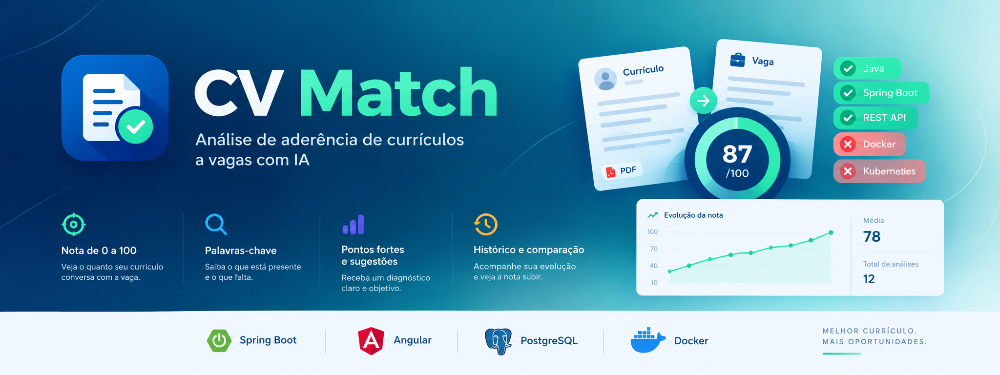
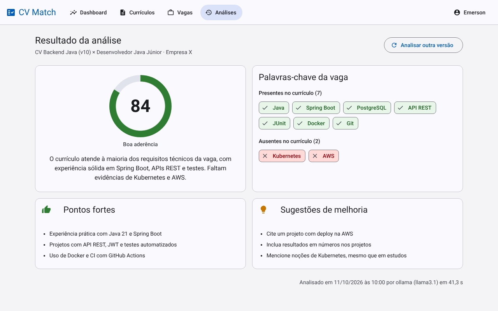
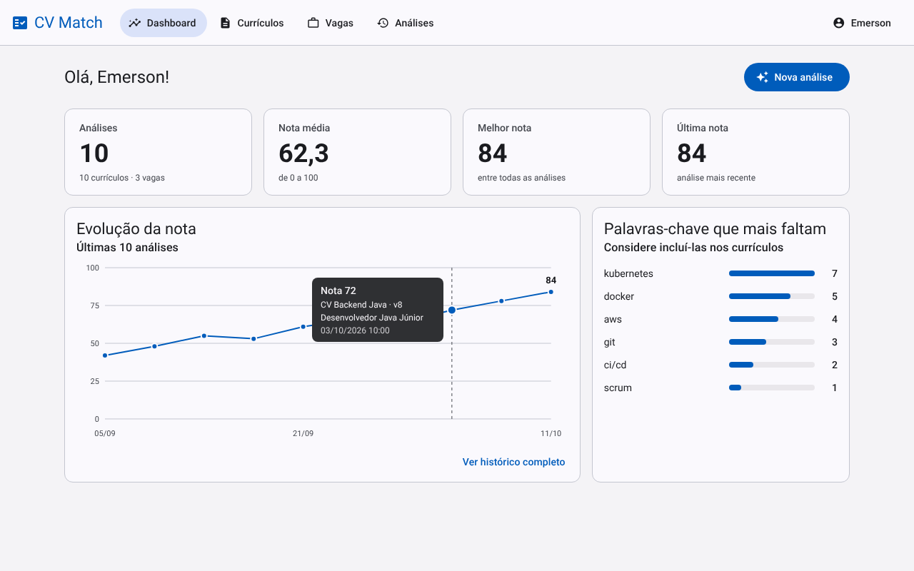
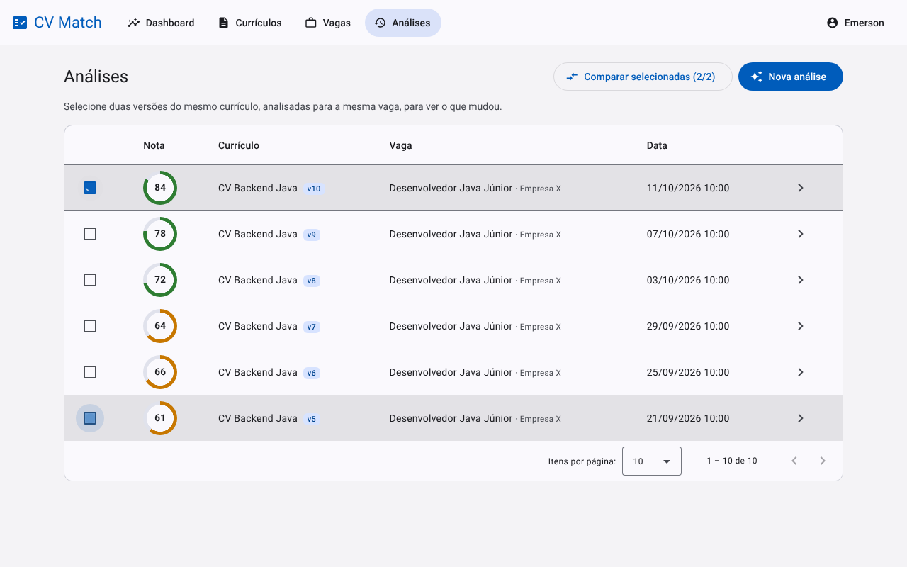
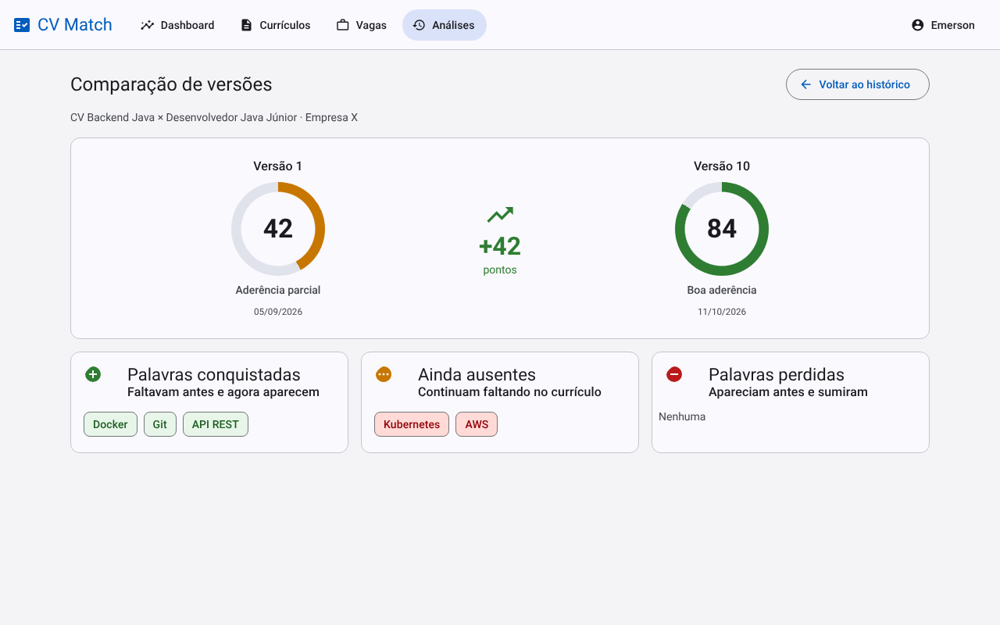
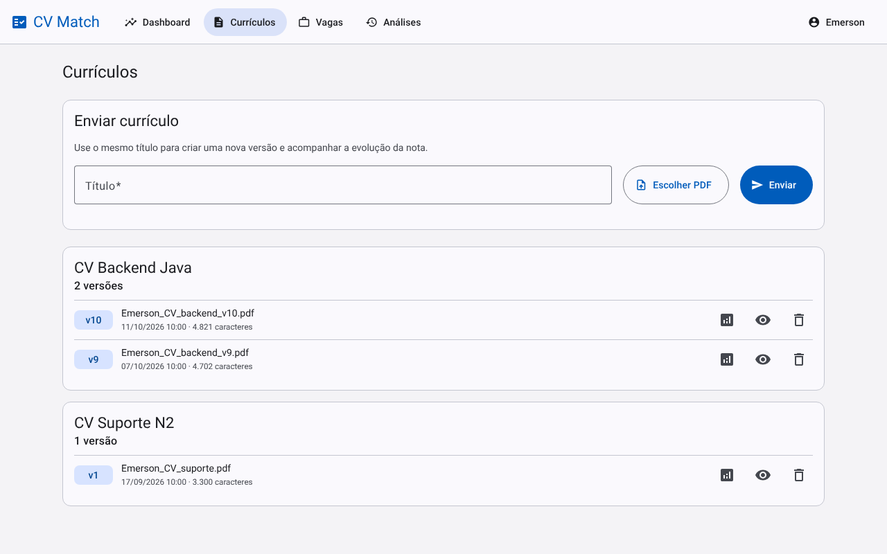
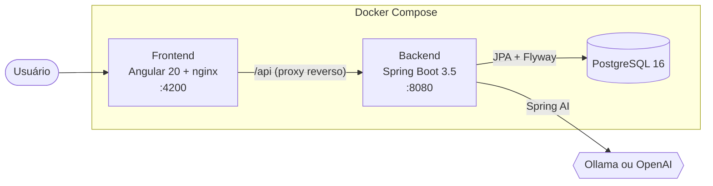
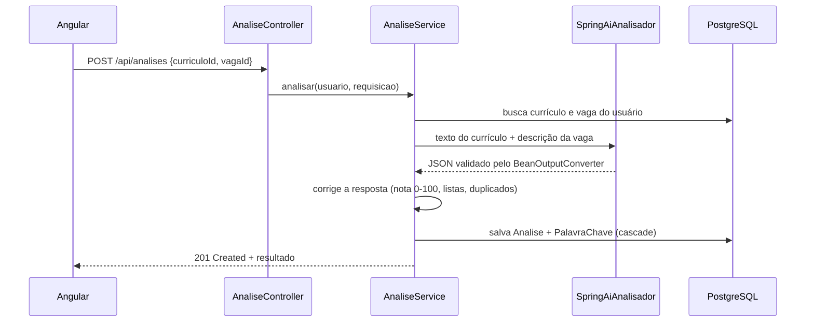
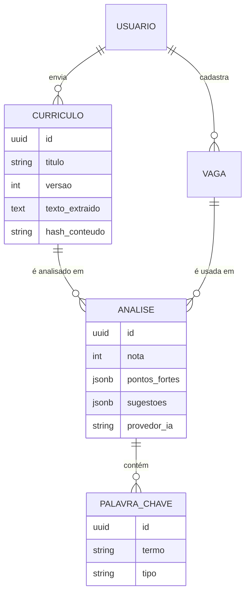

<p align="center">
  
</p>

> Descubra o quanto seu currículo combina com uma vaga, quais palavras-chave estão faltando e como melhorar, com análise feita por IA.


[](https://github.com/EmersonJun/CvTrack/actions/workflows/ci.yml)




## Sobre o projeto

Grande parte das empresas usa sistemas ATS para filtrar currículos antes que uma pessoa os leia. O **CV Match** simula essa leitura: você envia o currículo em PDF, cola a descrição da vaga e recebe:

- uma **nota de aderência de 0 a 100**;
- as **palavras-chave da vaga** que estão presentes e ausentes no currículo;
- **pontos fortes** e **sugestões de melhoria** específicas para aquela vaga.

Cada novo envio com o mesmo título vira uma **nova versão** do currículo. Assim dá para **comparar versões** e acompanhar a **evolução da nota** em um dashboard.

## Telas

| Dashboard | Histórico |
|---|---|
|  |  |
| **Comparação de versões** | **Currículos** |
|  |  |

## Funcionalidades

- Cadastro e login com **JWT**
- Upload de currículo em **PDF**, com extração do texto pelo **Apache PDFBox**
- **Versionamento** automático de currículos pelo título
- Cadastro de vagas colando a descrição
- Análise com **Spring AI** em JSON estruturado: nota, palavras-chave, pontos fortes e sugestões
- Provedor de IA configurável por variável de ambiente: **Ollama** (local e gratuito) ou **OpenAI**
- Histórico paginado e **comparação entre versões** do mesmo currículo para a mesma vaga
- Dashboard com indicadores, **gráfico de evolução da nota** e as palavras-chave que mais faltam
- Documentação da API com **Swagger/OpenAPI**

## Arquitetura



### Como uma análise acontece



A chamada à IA acontece **fora de uma transação do banco**: ela pode levar mais de um minuto, e segurar uma conexão esse tempo todo esgotaria o pool.

### Modelo de dados



## Stack

| Camada | Tecnologias |
|---|---|
| Backend | Java 21, Spring Boot 3.5, Spring Data JPA, Spring Security + JWT, Bean Validation, Spring AI 1.0, Apache PDFBox 3, MapStruct, Lombok |
| Banco | PostgreSQL 16, Flyway |
| Frontend | Angular 20 (standalone components + signals), Angular Material, Reactive Forms |
| Testes | JUnit 5, Mockito, Testcontainers, MockMvc, Jasmine e Karma |
| DevOps | Docker (multi-stage), Docker Compose, nginx, GitHub Actions |
| Documentação | Swagger / OpenAPI (springdoc) |

## Como rodar

### Com Docker (um comando)

Pré-requisito: [Docker Desktop](https://www.docker.com/products/docker-desktop).

```bash
git clone https://github.com/EmersonJun/CvTrack.git
cd CvTrack
cp .env.example .env
docker compose up --build -d
```

| Serviço | Endereço |
|---|---|
| Aplicação | http://localhost:4200 |
| Swagger | http://localhost:8080/swagger-ui.html |

### Escolhendo a IA

**Ollama no seu computador (padrão, gratuito)**

```bash
ollama pull llama3.1
```

O backend acessa o Ollama da máquina pelo endereço `host.docker.internal:11434`.

**Ollama dentro do Docker**

```bash
docker compose --profile ollama up -d
docker exec cvmatch-ollama ollama pull llama3.1
```

No `.env`, use `OLLAMA_DOCKER_URL=http://ollama:11434`.

**OpenAI**

No `.env`, use `AI_PROVIDER=openai` e preencha `OPENAI_API_KEY`.

### Para desenvolver

```bash
docker compose up -d postgres

cd backend
./mvnw spring-boot:run

cd ../frontend
npm install
npm start
```

O frontend sobe em http://localhost:4200 e repassa as chamadas `/api` para o backend pelo `proxy.conf.json`.

## Variáveis de ambiente

| Variável | Padrão | Descrição |
|---|---|---|
| `POSTGRES_DB` / `POSTGRES_USER` / `POSTGRES_PASSWORD` | `cvmatch` | Credenciais do banco |
| `DB_URL` | `jdbc:postgresql://localhost:5432/cvmatch` | URL do banco ao rodar o backend fora do Docker |
| `JWT_SECRET` | valor de desenvolvimento | Segredo do token, com no mínimo 32 caracteres |
| `JWT_EXPIRATION_MINUTES` | `60` | Validade do token |
| `CORS_ALLOWED_ORIGINS` | `http://localhost:4200` | Origens liberadas no CORS |
| `AI_PROVIDER` | `ollama` | `ollama` ou `openai` |
| `OPENAI_API_KEY` / `OPENAI_MODEL` | vazio / `gpt-4o-mini` | Configuração da OpenAI |
| `OLLAMA_BASE_URL` | `http://localhost:11434` | Ollama ao rodar o backend fora do Docker |
| `OLLAMA_DOCKER_URL` | `http://host.docker.internal:11434` | Ollama visto de dentro do container |
| `OLLAMA_MODEL` | `llama3.1` | Modelo usado no Ollama |

## Testes

| Parte | Comando | O que cobre |
|---|---|---|
| Backend | `cd backend && ./mvnw verify` | 101 testes: unitários com Mockito, repositories e integração HTTP com PostgreSQL real via Testcontainers |
| Frontend | `cd frontend && npm test` | 62 testes: services, interceptors, guards, componentes e o gráfico |

Os testes de integração do backend precisam do Docker aberto. A IA é substituída por um mock, então nenhum teste depende de um provedor externo.

## Integração contínua

A cada push, o GitHub Actions:

1. compila o backend e roda todos os testes, incluindo os de Testcontainers;
2. compila o frontend e roda os testes no Chrome headless;
3. valida o `docker-compose.yml` e constrói as imagens do backend e do frontend.

## API

| Recurso | Endpoints |
|---|---|
| Autenticação | `POST /api/auth/registro`, `POST /api/auth/login`, `GET /api/auth/me` |
| Currículos | `POST /api/curriculos` (multipart), `GET /api/curriculos`, `GET /api/curriculos/versoes?titulo=`, `GET /api/curriculos/{id}`, `DELETE /api/curriculos/{id}` |
| Vagas | `POST`, `GET`, `GET /{id}`, `PUT /{id}`, `DELETE /{id}` em `/api/vagas` |
| Análises | `POST /api/analises`, `GET /api/analises?pagina=&tamanho=`, `GET /api/analises/{id}`, `GET /api/analises/comparacao?anteriorId=&atualId=` |
| Dashboard | `GET /api/dashboard` |

Os erros seguem o padrão **Problem Details (RFC 9457)**. Erros de validação trazem a lista `campos`, que o frontend usa para marcar o campo certo no formulário.

## Decisões técnicas

- **Pacotes por funcionalidade** (`auth`, `curriculo`, `vaga`, `analise`, `dashboard`), com as camadas controller, service, repository, DTO e mapper dentro de cada um.
- **O PDF não é guardado**, apenas o texto extraído. Isso ocupa menos espaço e é melhor para a privacidade (LGPD). O arquivo é validado pelos primeiros bytes (`%PDF-`), e não pela extensão.
- **O hash SHA-256 do texto** impede enviar o mesmo currículo duas vezes.
- **Palavras-chave ficam em tabela própria**, porque são consultadas no dashboard. Pontos fortes e sugestões ficam em **JSONB**, porque só são exibidos.
- **A interface `AnalisadorIa`** isola o Spring AI do resto do código. Trocar de provedor é só configuração, e os testes usam um mock.
- **A resposta da IA nunca é usada sem tratamento:** a nota é limitada entre 0 e 100, e listas nulas, itens repetidos e termos contraditórios são corrigidos antes de salvar.
- **Proteção contra prompt injection:** o currículo e a vaga vão entre as tags `<curriculo>` e `<vaga>`, e o prompt manda ignorar instruções dentro delas.
- **Cada usuário só acessa os próprios dados:** toda consulta filtra pelo dono, e um recurso de outra pessoa responde 404, sem revelar que existe.
- **Constraints no banco** (nota entre 0 e 100, versão única por título, e-mail único) complementam o Bean Validation.
- **Frontend com signals, interceptors funcionais e lazy loading** por tela. O gráfico de evolução é feito em **SVG puro**, sem biblioteca externa.
- **Imagens Docker multi-stage**, com usuário não-root e health check. O nginx serve o Angular e faz o proxy reverso para a API, eliminando problemas de CORS em produção.

## Estrutura

```
CvTrack/
├── backend/                 Spring Boot
│   └── src/main/java/br/com/cvmatch/
│       ├── auth/            registro, login e perfil
│       ├── curriculo/       upload, PDFBox e versões
│       ├── vaga/            CRUD de vagas
│       ├── analise/         IA, histórico e comparação
│       ├── dashboard/       indicadores e evolução
│       ├── security/        JWT e filtros
│       ├── config/          segurança e OpenAPI
│       └── common/          entidade base, erros e utilitários
├── frontend/                Angular
│   └── src/app/
│       ├── core/            serviços, interceptors, guards e modelos
│       ├── layout/          barra de navegação
│       ├── features/        telas
│       └── shared/          indicador de nota, gráfico e diálogos
├── docs/prints/             imagens deste README
├── docker-compose.yml
└── .github/workflows/ci.yml
```

## Próximos passos

- Processar a análise de forma assíncrona, com fila e notificação ao concluir
- Trocar o token no `localStorage` por cookie `httpOnly` com refresh token
- OCR para currículos escaneados
- Publicar a aplicação em nuvem

## Autor

Feito por **Emerson** · [github.com/EmersonJun](https://github.com/EmersonJun)

## Licença

Distribuído sob a licença MIT. Veja [LICENSE](LICENSE).
